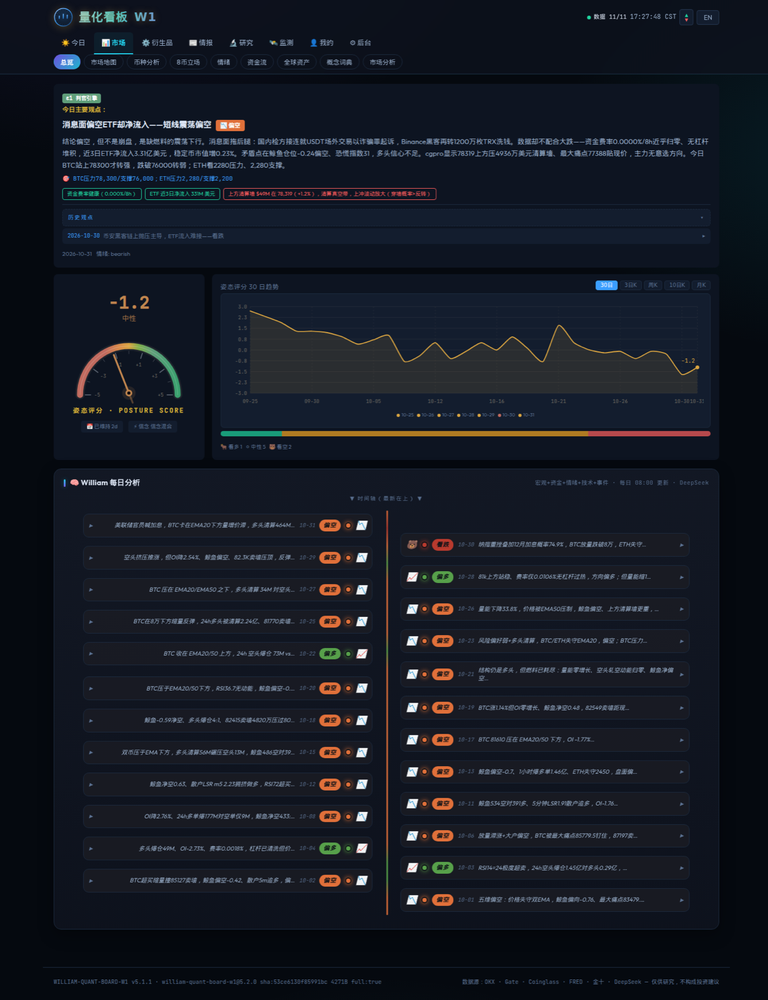
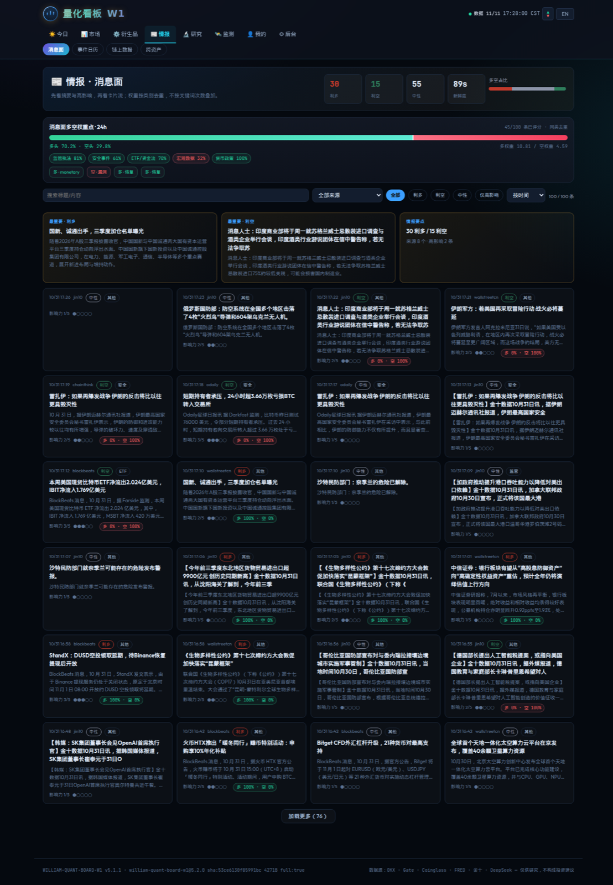
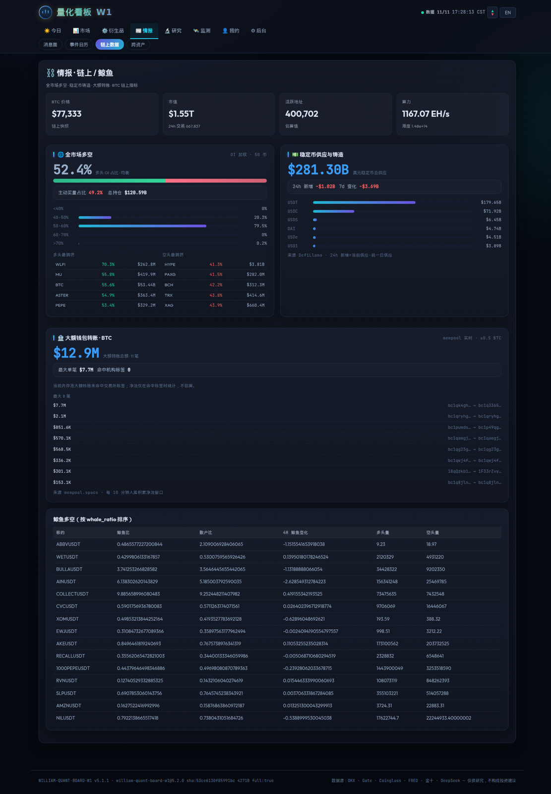
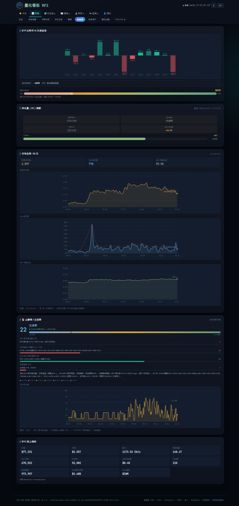

# W1 Quant Board · Crypto Market Monitoring Terminal

<p align="center">
  <a href="https://www.7baobtc.com"></a>
  
  
</p>

> ### 🟢 实机演示 / Live Demo
> **<https://www.7baobtc.com>** — 公开可访问的实机运行面板（生产环境，非录屏、非静态图）。
>
> ### ⚠️ 授权 / License
> 本项目**仅授权非商业用途**。**任何商业使用（含 SaaS、付费产品、企业内部生产、二次销售、托管服务）必须事先取得作者书面授权**；未获授权即商用，作者将依法追究法律责任。
> **Commercial use of any kind requires a prior written license. Unauthorized commercial use will be pursued to the fullest extent permitted by law.**
> 授权联系 / Licensing: <https://www.7baobtc.com> · GitHub [@William-Trader](https://github.com/William-Trader)

**中文** ｜ **English**

> **定位 / Positioning**：面向交易者与社群运营者的 crypto 市场监测终端：行情、多空 LSR、费率、清算、新闻、宏观、研究与回测，支持 QQ / Telegram / Discord 告警。  
> **A crypto market-monitoring terminal for traders and community operators: quotes, LSR, funding, liquidations, news, macro, research and backtesting, with QQ / Telegram / Discord alerts.**
>
> **边界 / Scope**：只做数据加工、校验与展示；所有数据标注来源与新鲜度，不构成投资建议。  
> **Data processing, validation and presentation only; every data point carries its source and freshness. Not investment advice.**

---

## 实机截图 · Live Screenshots

> 以下截图来自 <https://www.7baobtc.com> 实机运行环境（2026-10-31）。

| 总览 Overview | 消息面 News |
|---|---|
|  |  |

| 链上 / 鲸鱼 On-chain | 资金流 Flows |
|---|---|
|  |  |

---

# 中文

## 1. 这是什么

W1 把分散的 crypto 市场数据整理成一套可读、可查、可告警的监测系统：

- **交易者**：看市场体制、仓位压力、清算结构、资金费率、新闻冲击、跨资产联动，辅助自己做决策。
- **社群运营者**：按模块和会员权限组合产品，接入 QQ / Telegram / Discord 等通知渠道，做实时提示与内容运营。
- **研究者**：用内置的回测/研究框架做因子、体制、事件研究，独立于任何交易执行。

数据主要来自 **Coinglass**，辅以 Gate/OKX 行情、新闻 RSS、ETF、宏观与链上公开数据。系统只做数据加工与展示，不替用户下单。

## 2. 功能矩阵

| 模块 | 提供什么 | 实现方式 |
|---|---|---|
| 总览 Overview | 市场判断、关键价位、情绪与仓位摘要 | 本地 SQLite 聚合 + 规则/AI 摘要；所有卡片带数据时间与新鲜度 |
| 8 币立场 | BTC/ETH/SOL 等主流币的多空立场 | 资金费率、OI、LSR、清算、价格结构多因子合成 |
| 山寨异动 Alt Radar | 近期热门山寨榜 + 15m/1h/4h 异动 | futures_markets 5min 序列；价格/OI/量变/费率/主动买卖/LSR/清算多因子打分；排除主流币/稳定币/代币化股票 |
| 情绪 Sentiment | 恐慌贪婪指数、历史分位、情绪趋势 | FGI 日更 + 8.5 年历史序列 |
| 资金流 Flows | 稳定币供应、ETF 流入、资金面变化 | Coinglass/ETF 数据 + 稳定币供应采集 |
| 全球资产 Global | 美股、商品、加密等跨资产行情 | OKX 代币化标的 + 全球指数；67 个标的、5 分钟级 |
| 市场分析 Market | 宏观、结构、体制与关键事件 | 规则引擎 + 宏观日历 + 研究模块 |
| 链上数据 On-chain | BTC 链上价格、市值、交易数、活跃地址 | 公开链上接口 + 本地缓存 |
| 清算数据 Liquidation | 8 所清算、清算墙、最大痛点 | Coinglass 多所清算 + CoinGlass Pro 快照 |
| 筹码分布 Chip | 持仓成本/筹码结构 | 本地聚合 + 图表 |
| 多空 LSR | 散户/大户多空比、极值 | Coinglass LSR + 历史分位 |
| 费率套利 Funding | 跨所资金费率与套利差 | Coinglass funding + 本地序列 |
| 消息面 News | 8 个来源的实时新闻与情绪 | RSS/接口采集 + 去重 + 情绪标签 |
| 监测 Monitor | 统一告警、SLO、评分卡 | 告警状态机 + 数据源 SLO + 前瞻结果评分 |
| 研究 Research | 体制实验室、仓位压力、新闻冲击、跨资产、逐日回放、市场风险 | 独立研究模块，会员可见；详见第 5 节 |

## 3. 数据源与更新节奏

| 数据 | 来源 | 频率 | 说明 |
|---|---|---|---|
| 合约行情/OI/费率 | Coinglass | 5 分钟 | 50 个主流币，写入本地快照 |
| LSR 多空比 | Coinglass | 5 分钟 | 散户/大户，保留历史序列 |
| 清算 | Coinglass（8 所） | 30 分钟 | Binance/OKX/Bybit/Bitget/HTX/Gate/MEXC/KuCoin |
| 恐慌贪婪 | alternative.me / Coinglass | 3 小时采样 | 上游日更，历史可回溯到 2018 |
| 新闻 | 金十/深潮/律动/链智库/华尔街见闻/CoinTelegraph/Decrypt/Cryptonews | 实时轮询 | 去重、来源标记、情绪标签 |
| ETF | Coinglass | 2 小时 | BTC ETF 流入序列 |
| 宏观/全球资产 | FRED / 公开接口 / OKX | 日更或 5 分钟 | 利率、指数、商品、代币化股票 |
| 链上 | 公开接口 | 小时级 | 价格、市值、交易数、活跃地址 |

**新鲜度纪律**：接口返回 `data_ts`/`age_sec`/`stale`，页面顶栏与 `/api/health/sources` 可直接看到数据是否过期；过期数据不会伪装成实时。

## 4. 告警与 Bot 通知工程

### 4.1 告警中心

- 统一 `alerts` 表：`open → ack / silenced → resolved`，记录确认人、静默截止、恢复时间、重复次数。
- 严重级别 P0/P1/P2；同一 `dedup_key` 只保留一条活动告警。
- 评分卡：每条带币种告警记录 15m/1h/4h/24h 远期收益、MFE/MAE、命中率。
- SLO：每源成功率、p95 延迟、错误预算燃烧率；`/metrics` 输出 Prometheus 文本。

### 4.2 通知适配器

系统内置一套**与具体软件解耦**的通知工程层（`lib/notify/`）：

| 渠道 | 适配方式 | 配置 |
|---|---|---|
| Telegram | Bot API `sendMessage` | `TELEGRAM_BOT_TOKEN` + `TELEGRAM_CHAT_ID` |
| Discord | Webhook `content` | `DISCORD_WEBHOOK_URL` |
| Slack | Incoming Webhook `text` | `SLACK_WEBHOOK_URL` |
| 通用 Webhook | POST JSON `{text, meta}` | `GENERIC_WEBHOOK_URL` |
| QQ 群 | 复用现有 `pushToGroup` | 现有 QQ 配置 |

- 配置文件：`config/notify.json`（参考 `config/notify.example.json`）。
- 默认 **dry-run**：只生成 payload，不发真实请求；设置 `NOTIFY_LIVE=1` 且配置齐全才真实发送。
- 统一超时 10s、错误返回、按渠道独立配置；不要求也不执行实际连接测试。
- 管理员接口：`GET /api/notify/channels`、`POST /api/notify/send`（默认 dry-run）。

### 4.3 面向社群运营

- 会员/审批制：公开页、会员页、后台三层。
- 可按模块组合产品：行情监测、清算/LSR、新闻、研究、告警。
- 通知渠道可插拔：同一套告警可接 QQ 群、Telegram 频道、Discord 社区或自有 Webhook。

## 5. 研究与回测框架

研究页签只做数据分析与回测，不提供交易执行：

| 模块 | 数据 | 用途 |
|---|---|---|
| 体制实验室 | BTC 1h，2017→2026（约 5.9 万根） | 趋势/震荡/高波动分类；未来 24h 统计；通用策略范式对比 |
| 仓位压力 | 约 7.5 个月费率/OI/LSR + 8 所清算 | 0–100 压力分、被套方向、费率 z 与未来 4h 收益验证 |
| 新闻冲击 | 30 天约 18.6 万条新闻 × BTC 5m | 来源/情绪命中率、1h/4h 冲击 |
| 跨资产 | 67 个标的、约 2 个月 5m | 风险偏好、广度、BTC 相关性、轮动 |
| 逐日回放 | 5m K线 + 新闻 + 因子快照 | 回看某日行情与事件，不含策略信号 |
| 市场风险 | BTC 日线 | 回撤、VaR95/CVaR95、年化波动、Sharpe |

**回测框架**：`lib/backtest.js`、`lib/backtest_wsl.js`、`lib/indicators.js` 与相关脚本保留，用于研究；不包含上线策略，也不产生交易指令。

**样本限制**：另类数据（费率/LSR/清算/跨资产）只有 2–7.5 个月，不能冒充长周期结论；所有页面都标注数据窗口。


## 5A. 价格源、计算公式与回测严谨性（2026-10-31 精度升级）

> 这一节回答三个问题：**每个推送数字从哪来、怎么算、凭什么可信**。所有公式都可按文中命令复算。

### 5A.1 价格：多源加权 + 跨源校验

W1 的价格不再由单一接口直接给出。`lib/precision.js` 把两路独立报价合并：

| 源 | 采集 | 字段 | 用途 |
|---|---|---|---|
| Gate 现货 | 60s | `prices.price` | 现货基准 |
| Coinglass 合约聚合 | 5min | `futures_markets.current_price` | 合约基准 |

**加权公式**

```
dev_i   = (p_i - median(p)) / median(p) × 100          # 偏离中位数
q_i     = 1.0  if |dev_i| ≤ 0.3%
        = 0.25 if 0.3% < |dev_i| ≤ 1%
        = 0.0  if |dev_i| > 1%                          # 异常源剔除
w_i     = (v_i × q_i) / Σ(v_j × q_j)                    # v_i = 24h 成交额
cap     = 0.60                                          # 单源权重上限
p_price = Σ(w_i × p_i)
```

三条防退化规则：

1. **任一源缺成交量 → 全源等权**（Coinglass `volume_24h_usd` 实测缺失，旧代码把缺失当 0，导致加权价只剩单源的 60%，BTC 曾算出 46,432 而真实价约 77,400）。
2. **两源互相矛盾（都偏离中位数 >1%）→ 不平均**，只采用成交量最大的源，并标 `data_warn`。
3. **单源时权重必须为 1**，60% 上限只在 ≥2 个有效源时生效。

**校验阈值**：跨源偏差 >0.5% 标 `DATA_WARN`；最新源龄期 >900s 标 `stale`。置信度：

- `high`：≥2 源、最大偏差 ≤0.15%、最新源 ≤300s
- `medium`：≥2 源且偏差 ≤0.5%，或单源但新鲜
- `low`：其它（含无共识、滞后）

**24 小时实测（2026-10-31，243 个对齐快照）**

| 币 | 平均绝对偏差 | p95 | 最大 |
|---|---|---|---|
| BTC | 0.0193% | 0.0457% | 0.0903% |
| ETH | 0.0543% | 0.0899% | 0.1449% |

结论：0.5% 告警线约为常态偏差的 5–10 倍，不会天天误报；两源一致性足以支撑推送报价。

### 5A.2 多空比：三个分母，禁止混用

Coinglass 返回的 `ratio` 不是「人数多空」，而是**持仓名义价值多空比**：

```
持仓名义多空 notional = long_notional / short_notional
账户数多空   account  = long_traders  / short_traders
大户持仓多空 whaleQty = whale_long_qty / whale_short_qty
全市场持仓   ovQty    = ov_long_qty   / ov_short_qty
```

**实测对账（BTC，2026-10-31 11:00 北京）**

| 口径 | 值 | 说明 |
|---|---|---|
| notional | 0.2458 | `693,369,428.86 / 2,821,105,178.34` |
| vendor `ratio` | 0.2458 | 与重算完全一致（cross-check 0.000%） |
| account | 0.6489 | `1,081 / 1,666` |
| whaleQty | 0.2165 | 大户持仓量比 |
| ovQty | 0.2458 | 与 notional 偏差 0.027% |

**口径纪律**

- 推送与 `/多空` 命令：同时展示三个分母，并注明「名义 / 账户 / 大户」。
- 评分层（SmartSignal 资金维度）：使用 `futures_markets.long_short_ratio_4h`（OKX 4h **账户**口径），因为固定阈值 1.6/0.6 是按该口径与回测 `lsr_account` 标定的；**不能**拿持仓名义比套 1.6/0.6，两者中位数差 3–10 倍。
- 交叉校验：`|notional − vendor| / vendor > 0.5%` → `data_warn`。
- 榜单盲区：`lsr_rankings` 按 `delta_2m` 排序，实测前 50/100 行不含 BTC/ETH；主流币必须走 `lsr_signals`（显式请求）。旧 `/多空` 只读榜单，会把山寨当主流。

**4 小时前瞻验证（BTC，20,042 个对齐样本，2026-08→10）**

| 分位桶 | n | 平均 4h 收益 | 中位数 | 胜率 | t |
|---|---|---|---|---|---|
| ≤ p5（空头极拥挤） | 1,003 | **+0.321%** | +0.134% | 63.7% | **10.96** |
| p5–p25 | 4,008 | +0.021% | -0.014% | 49.5% | 1.67 |
| p25–p75 | 10,021 | +0.064% | +0.037% | 54.3% | 8.53 |
| p75–p95 | 4,008 | -0.021% | -0.003% | 49.7% | -1.90 |
| ≥ p95（多头极拥挤） | 1,002 | +0.019% | +0.022% | 54.5% | 0.62 |

`corr(log LSR, 4h 收益) = -0.0377`。结论：**极端空头拥挤有统计显著的正向反弹（t=10.96），极端多头拥挤没有对称的下跌证据**。因此 LSR 只作为拥挤度上下文与小权重因子，不单独构成交易信号。

### 5A.3 其它口径修正（本次一并修掉的隐性 bug）

| 项目 | 旧问题 | 现在 |
|---|---|---|
| 资金费率 | `avg_funding_rate_by_oi` 已是百分数（0.009474 = 0.009474%/8h），推送又 ×100 → 显示 0.95%，放大 100 倍；默认阈值 0.0015 比正常费率低一个量级，正常行情天天报「多头拥挤」 | 直接显示 `0.009%/8h`；阈值 `max(0.03, p95×1.5)`、极端 `max(0.06, ×1.5)`、上限 0.2%；自适应按该币 90 日 p95 |
| 恐惧贪婪 | 上游日更，旧代码把相邻两条（可能同一天）叫「突变」 | 只有间隔 ≥20h 才算「日变动」，文案标注「对比前一交易日」 |
| 清算汇总 | 8 所采集节奏不同（实测 MEXC/KuCoin 曾滞后 30min、值为 0），旧代码把旧 24h 值一起相加 | 只汇总 45min 内新鲜快照，推送写「参与交易所 N 家」并列出被剔除的所 |
| 宏观 FRED | `observations` 是**最新在前**的降序数组，旧代码取 `o[length-1]` 拿到最旧一条（VIX 差 3 天、美元指数更久） | 按 `date` 降序取第 1/2 条，并校验观测龄期（T10Y3M/VIX ≤10 天，美元 ≤14 天），推送带观测日期 |
| 健康巡检 | `futures_markets` 5min 采集却设 90min 阈值，一小时断供不报警；`funding_arb` 同样过宽；consensus 被误移出巡检 | 合约 20min、费率套利 30min、KOL 共识 2h；恢复 consensus 巡检 |
| SmartSignal 盈亏比 | `rr = CFG.t2_mult`，但 T1/T2 被止盈缓冲下调，实际 RR 被虚报 | 按真实价位重算 `rr=(t2-entry)/(entry-stop)`，并同时给 `rr1`；实测 2.34–2.38 而非配置的 2.5 |
| SmartSignal 仓位 | 文案写「建议 X% 仓位 / 单笔风险≤2%」，与实际风险定仓不是同一套数 | 推送直接给：名义 $、名义/权益倍数、保证金 $、风险 $、风险占权益 %，全部由 `notional` 与止损距离复算 |
| SmartSignal 数据完整度 | 缺维度时静默按 0 分参与，五维显示成「0」 | 每维带 `ok` 标记；缺 ≥2 维直接不出单；推送显示 `五维(4/5)` 与缺失项，缺失维度显示 `—` |
| 方向引擎风险 | 只写配置 `R=2%`，未反映 `posPct` 上限截断后的真实风险 | 推送写「风险预算 R=2%（实际 x.xx% 权益）」、止损距离、保证金/名义占权益 |
| 平仓播报 | 只有盈亏 %，没有 R 倍数 | 增加 `≈±x.xxR（止损距离 y%）`，与风险定仓同口径 |
| β1 引擎入库 | `margin_usd` 被误当 `risk_usd` 回退值写入，风险金额被高估 | 分别写 `margin_usd` 与 `risk_usd`，缺值写 NULL |

### 5A.4 回测严谨性证明

**数据覆盖（必须先看，否则会误读收益）**

| 数据 | 覆盖 | 备注 |
|---|---|---|
| BTC 1h K 线 | 2018-01-01 → 2026-10-31（59,845 根） | 回测主数据 |
| 五维因子 | 2026-03-08 → 2026-08-21 | 完整五维仅约 5.5 个月 |
| 新闻历史 | **0 条**（回测内 `news null→null`） | 消息面维度实际缺失，回测是 3–4 维 |
| KOL 共识 | 2026-08-11 → 2026-10-30 | |
| OKX 账户 LSR | 至 **2026-08-21** | 之后 `nearestMap` 会复用 1.1 旧值，不能当有效信号 |
| FGI | 2018-02-01 → 2026-10-30 | 日更 |

**当前回测结果（窗口 2026-08-11 → 2026-10-31，9 标的 × 4h，复利 1000U、50x、双边 8bps）**

| 指标 | 值 |
|---|---|
| 交易数 | 9（6W / 3L） |
| 胜率 | 66.7% |
| 总盈亏 | +256.41U（+25.64%） |
| 盈亏比 / PF | 6.05 / 12.10 |
| 最大回撤 | 2.22% |
| 夏普 / 索提诺 / 卡玛 | 4.04 / 2.19 / 81.04 |
| 年化 CAGR | 179.9% |
| 平均持仓 | 40.9h |
| BTC 买入持有 | +20.67% |

**统计检验（脚本可复跑）**

| 检验 | 结果 | 解读 |
|---|---|---|
| 符号置换 `p(胜率≥66.7%)` | **0.2604** | 胜率不显著，9 笔样本太小 |
| 符号置换 `p(总盈亏≥+256U)` | 0.0336 | 盈亏幅度显著 |
| 符号置换 `p(PF≥12.1)` | 0.0324 | PF 显著 |
| Bootstrap 胜率 95%CI | [33.3%, 100.0%] | 区间极宽，不能当稳定胜率 |
| Bootstrap 总盈亏 95%CI | [+58.34U, +463.10U] | 方向为正但区间宽 |
| Deflated Sharpe（N=12 次试验） | DSR = 100.0%（观测 SR 3.40，SR₀ 0.251） | 多重检验校正后仍 >95% |

**结论（不美化）**

1. 9 笔、全部集中在 2026-08，且新闻维度为空、OKX LSR 在 08-21 后失效——**这不是“长期稳定盈利”的证明，只是链路与统计方法的验证**。
2. 胜率检验 `p=0.26`，不显著；显著的是盈亏幅度与 PF，但由少数大盈利单驱动，`n<30` 时极易翻转。
3. DSR 100% 只说明「考虑 12 次调参后，观测 SR 不太可能是纯运气」，不说明未来可复制。
4. 因此 README 不把回测年化当业绩承诺；实盘/影子盘继续独立记账，样本 ≥30 后再做胜率结论。

**复跑命令**

```bash
cd /home/ubuntu/w1-board
node scripts/tianji_backtest.js --ui                 # 生成 data/tianji_bt_latest.json
node scripts/tianji_permutation.js --n 5000          # 置换检验 + Bootstrap
node scripts/tianji_deflated_sharpe.js --trials 12   # Deflated Sharpe
node scripts/tianji_walkforward.js --from 2026-03-08 --to 2026-08-31
```

### 5A.5 两个 Coinglass 源的职责分离与选源（2026-10-31）

系统里有两个**独立 key / 独立 base** 的 Coinglass 上游，禁止交叉使用：

| 源 | 上游 | 配额/节奏 | 负责的数据 |
|---|---|---|---|
| `fast` | `vip2.coinglass.site`（w1-board 自有 key） | 自适应 3–10 rpm；5min | 现价、多空 LSR、费率、OI、**实时爆仓聚合**、ETF、FGI |
| `full` | `api.alphanode.work`（cglass-pro 自有 key） | 约 1 rpm；端点轮转 | 清算墙、清算热力图、最大痛点、鲸鱼仓位分布 |

**选源规则**（`lib/source_router.js`，公开 `GET /api/sources`）：

1. **同类型数据优先更快/更省者**：实时爆仓从「8 所 8 次调用」改为 vip2 一次聚合 `coin-list`（覆盖 8 所），耗时与配额都下降一个量级；多空 LSR 主流币走 1 次 `lsr_signals` 批量，不再依赖可能不含 BTC/ETH 的榜单。
2. **需要更全数据时用 full**：清算墙/热力图/最大痛点/鲸鱼仓位优先读 cglass-pro 的 `cgpro_snapshots`（全量 Pro 端点），缺失或超过 30min 才回退 fast 聚合。
3. **主源过期自动回退**：fast 阈值 900s、full 阈值 1800s；`/api/sources` 返回每个数据类型的 `chosen/age_sec/stale/fallback_used/reason`。
4. **请求错峰**：LSR 榜单降到 10min/轮且只看 1 页；signals 5min、费率 10min、清算聚合 10min、共识 10min 分散到不同分钟，避免整点叠加 429。

### 5A.6 山寨异动系统（Alt Radar，2026-10-31）

- **覆盖范围**：`futures_markets` 前 50 中的山寨（有 OI/价格历史），排除 BTC/ETH/SOL/BNB/XRP/DOGE/ADA/LINK/SUI/XAU、稳定币、法币对、代币化股票/指数（GOOGL/SOXL/SNDK/SPCX/SKHYNIX 等）。
- **异动指标**：15m/1h/4h 收益率（5min 序列回溯）、OI 24h 变化、成交量变化、资金费率、主动买/卖量比、账户 LSR、持仓名义 LSR、24h 清算多空失衡。
- **触发规则**：至少 2 个独立标签，或单个强触发（15m≥5%、1h≥8%、|OI|≥20%、费率≥0.10% 或 ≤-0.08%）；评分 0–100，低于 45 不推。
- **防刷屏**：单币 30min 冷却；全系统 2 条/小时、10 条/天；23:00–08:00 只推评分 ≥80 的强异动；热门榜夜间不推。
- **两类消息**：
  - `🔥【W1·山寨异动】`：最多 5 个，逐币给 15m/1h/24h、OI、量变、费率、LSR、主动买卖、标签、评分。
  - `🔥【W1·热门山寨】`：Top 8，按「流动性 × 24h 动量 × OI 变化 × 量变」排序，60min 一次，Top 集合变化或满 4h 才重推。
- **接口**：`GET /api/alt-radar` 返回 `{as_of, universe, hot[], anomalies[]}`，60s 缓存；定时任务每 15min（:03/:18/:33/:48）扫描。
- **数据证据**：每条消息带 `Coinglass 5min · HH:MM 北京｜样本 N`，评分与标签可回算。

### 5A.7 每条固定推送现在带什么

| 推送 | 触发 | 计算 | 证据字段 |
|---|---|---|---|
| SkyEye 价格异动 | 15min 变动 ≥ 自适应阈值 | 首末各 3 点中位数，≥5 样本 | 起止价、样本数、2 源加权偏差、时间 |
| SkyEye 爆仓风暴 | 单币 24h 清算 ≥$1 亿 | 8 所只计 45min 内快照 | 多/空爆仓额、参与所数、剔除名单 |
| SkyEye 情绪日变动 | FGI 日变动 ≥10 | 仅比较间隔 ≥20h 的两条 | 前值→今值、间隔小时 |
| SkyEye 多空极端 | 持仓名义 ≥2 或 ≤0.5 | notional + account 双口径；同轮多币合并为一条摘要 | 两口径数值、口径说明、合并币数 |
| 市场监测·费率拥挤 | 费率 ≥ 自适应阈值 | 原始百分数，阈值=max(0.03, p95×1.5) | 费率 %/8h、阈值 |
| 市场监测·OI 异动 | 24h OI 变动 ≥5% | 百分比 + 绝对 OI + 增量 $ | 三项齐全，缺值写 — |
| 市场监测·多空结构 | 名义/账户背离，或 30m Δ≥0.15 | 三口径 + 60 日上下文 | 名义/账户/大户、30m 变化 |
| 市场监测·爆仓雷达 | 30min 新增爆仓 ≥$3000 万 | 增量 + 上下方墙 + 距离 + 清算比 | 墙价位、距现价 %、参与所数 |
| 市场监测·宏观 | 状态翻转/VIX/美元异动 | 最新观测（按日期降序）+ 龄期校验 | 观测日期、现值 |
| 市场监测·KOL 翻转 | 共识 long↔short | 只读 ≤2h 数据 | 置信度、数据龄期 |
| SmartSignal | 五维共振 | 缺 ≥2 维不出单；RR 实算；风险定仓 | 五维完成度、RR/T1 RR、名义/保证金/风险、LSR 三口径、报价源 |
| 方向引擎给单 | 策略表达式触发 | 1h 收盘 vs 实时价偏差；风险复算 | 策略价、实时价、偏差、止损距离、实际风险 % |
| 数据断供 | 表龄超阈值 | 每表独立阈值 + 去重冷却 | 表名、断供时长 |
| 自动平仓 | 止盈/止损/超时 | 60% T1 + 40% 剩余；R 倍数 | 盈亏 %、R 倍数、止损距离、原因 |


## 6. 会员与权限

- 注册后需管理员审批；会员状态、到期时间、额度在 `users` 表。
- 前端 `TABS` 用 `pub:false` 控制会员栏目；后端对应接口用 `requireVip`。
- 后台 `requireAdmin`；owner 可管理用户与公告。
- 会话使用 httpOnly cookie，7 天有效；不在前端暴露密钥。

## 7. 技术架构

```
浏览器 SPA (public/index.html + app.js + app.css)
        │  /api/*
        ▼
Express server.js (:3300, 仅监听 127.0.0.1)
        │
        ├── 采集层 lib/collectors.js + node-cron
        │     Coinglass / Gate / 新闻 / 宏观 / ETF / 链上
        ├── 存储层 SQLite WAL (data/w1.db)
        │     历史 payload gzip 压缩 + 保留期清理
        ├── 分析层 lib/verdict.js / research/*
        ├── 告警层 lib/alerts.js + health_guard + skyeye + market_watch
        ├── 通知层 lib/notify/ (Telegram/Discord/Slack/Webhook/QQ)
        └── 输出层 REST API + /metrics + QQ/社群推送
```

- **单进程 + SQLite**：部署简单，适合个人/小团队；重任务不得阻塞 API。
- **WAL + 定期 checkpoint**：读写并发；历史 payload 压缩降低体积。
- **静态资源**：`app.css`/`app.js` 带内容哈希；改完必须更新 `index.html` 的 `?v=`。
- **公网入口**：nginx 反代到 `127.0.0.1:3300`，HTTPS 由证书管理。

## 8. 主要 API

| 接口 | 权限 | 内容 |
|---|---|---|
| `/api/version`、`/healthz` | 公开 | 版本/健康 |
| `/api/overview`、`/api/coins`、`/api/fear-greed` | 公开 | 总览/币种/情绪 |
| `/api/health/sources`、`/api/data-quality` | 公开 | 数据新鲜度/质量 |
| `/api/liquidation`、`/api/lsr`、`/api/funding`、`/api/news` | 会员 | 清算/LSR/费率/新闻 |
| `/api/alerts`、`/api/alerts/scorecard`、`/api/slo` | 会员 | 告警/评分卡/SLO |
| `/api/research/*` | 会员 | 体制/仓位/新闻/跨资产/回放/风险 |
| `/api/notify/channels`、`/api/notify/send` | 管理员 | 通知渠道与 dry-run 发送 |
| `/metrics` | 公开 | Prometheus 指标 |
| `/api/okx/*`、`/api/signal/*`、`/api/strategy/*`、`/api/unified/*` | — | **410 Gone：交易执行接口未开放** |

## 9. 部署

```bash
npm install
cp .env.example .env       # 填入 Coinglass/QQ 等密钥，chmod 600
npm start                  # :3300
npm test                   # 语法 + 纯函数 + 告警 + 研究测试
```

- 生产：PM2 `w1-board` + nginx 反代；服务器仅监听 `127.0.0.1:3300`。
- 密钥只放 `.env`（600），不入库、不回显。
- 数据备份：每日 `.backup` 到 `/home/ubuntu/backups/db/`；研究/回测产物写 `/tmp`。

## 10. 数据保留与性能

- `data/w1.db`：WAL；历史 JSON payload 超过保留窗口后压缩为 gzip BLOB，读取时透明解压。
- 保留期：行情快照/清算/费率等按表配置；访问日志 90 天；SLO 日汇总 30 天。
- `/api/data-quality`：每表行数、最新时间、压缩行占比、DB 可回收页。
- 重计算模块带 2–10 分钟缓存；首屏慢先看服务端耗时，不先改前端。

## 11. 限制与合规

- 依赖第三方数据源，上游限流/超时会导致短时缺口；页面会标记 stale。
- 研究结论受样本窗口限制，不构成收益承诺。
- 本项目**不提供交易建议、不代客理财、不执行下单**。
- 历史策略与运行记录已删除；保留的回测/研究代码仅用于分析。
- 使用前请自行确认当地法律与数据源条款。

## 12. License

PolyForm Noncommercial 1.0.0。仅限非商业研究使用；商业授权请联系仓库所有者。

---

# English

## 1. What It Is

W1 turns fragmented crypto market data into a readable, searchable and alertable monitoring system:

- **For traders**: market regime, positioning stress, liquidation structure, funding, news impact and cross-asset context — decision support, not signals.
- **For community operators**: compose products from modules and membership tiers; deliver real-time alerts to QQ, Telegram, Discord or custom webhooks.
- **For researchers**: use the built-in research/backtest framework for factor, regime and event studies, independent of any trade execution.

Primary data comes from **Coinglass**, supplemented by Gate/OKX quotes, news RSS, ETF, macro and on-chain public data. The system processes and displays data; it never places orders.

## 2. Feature Matrix

| Module | What it provides | Implementation |
|---|---|---|
| Overview | Market view, key levels, sentiment and positioning summary | Local SQLite aggregation + rules/AI summary; every card carries data timestamp and freshness |
| 8-Coin Stances | Long/short stance for BTC/ETH/SOL and other majors | Funding, OI, LSR, liquidation and price-structure composite |
| Sentiment | Fear & Greed, historical percentile, trend | Daily FGI + 8.5-year history |
| Flows | Stablecoin supply, ETF flows, capital conditions | Coinglass/ETF data + stablecoin supply collection |
| Global Assets | US equities, commodities and crypto | OKX tokenized instruments + global indices; 67 symbols at 5-minute cadence |
| Market Analysis | Macro, structure, regime and key events | Rule engine + macro calendar + research modules |
| On-Chain | BTC price, market cap, transactions, active addresses | Public on-chain APIs + local cache |
| Liquidation | 8-venue liquidations, liquidation walls, max pain | Coinglass multi-venue data + CoinGlass Pro snapshots |
| Chip Distribution | Cost basis / chip structure | Local aggregation + charts |
| LSR | Retail/whale long-short ratio and extremes | Coinglass LSR + historical percentile |
| Funding | Cross-venue funding and arbitrage spread | Coinglass funding + local series |
| News | Real-time news and sentiment from 8 sources | RSS/API collection + dedup + sentiment tags |
| Monitor | Unified alerts, SLO, scorecards | Alert state machine + source SLO + forward-outcome scoring |
| Research | Regime lab, positioning stress, news impact, cross-asset, daily replay, market risk | Independent research modules; members only; see Section 5 |

## 3. Data Sources & Cadence

| Data | Source | Frequency | Notes |
|---|---|---|---|
| Futures/OI/Funding | Coinglass | 5 min | 50 majors, stored as local snapshots |
| LSR | Coinglass | 5 min | Retail/whale, historical series retained |
| Liquidation | Coinglass (8 venues) | 30 min | Binance/OKX/Bybit/Bitget/HTX/Gate/MEXC/KuCoin |
| Fear & Greed | alternative.me / Coinglass | 3-hour sampling | Upstream daily; history back to 2018 |
| News | Jin10/Odaily/BlockBeats/ChainThink/WallstreetCN/CoinTelegraph/Decrypt/Cryptonews | Real-time polling | Dedup, source labels, sentiment |
| ETF | Coinglass | 2 h | BTC ETF flow series |
| Macro/Global | FRED / public APIs / OKX | Daily or 5 min | Rates, indices, commodities, tokenized equities |
| On-chain | Public APIs | Hourly | Price, market cap, transactions, active addresses |

**Freshness discipline**: APIs expose `data_ts`/`age_sec`/`stale`; the top bar and `/api/health/sources` show whether data is stale. Stale data is never presented as real-time.

## 4. Alerts & Bot Notification Engineering

### 4.1 Alert Center

- Unified `alerts` table: `open → ack / silenced → resolved`, with acknowledger, silence deadline, resolution time and repeat count.
- Severity P0/P1/P2; one active alert per `dedup_key`.
- Scorecards: 15m/1h/4h/24h forward return, MFE/MAE and hit rate for symbol-bearing alerts.
- SLO: per-source success rate, p95 latency and error-budget burn; `/metrics` exposes Prometheus text.

### 4.2 Notification Adapters

A software-agnostic notification layer (`lib/notify/`):

| Channel | Adapter | Configuration |
|---|---|---|
| Telegram | Bot API `sendMessage` | `TELEGRAM_BOT_TOKEN` + `TELEGRAM_CHAT_ID` |
| Discord | Webhook `content` | `DISCORD_WEBHOOK_URL` |
| Slack | Incoming Webhook `text` | `SLACK_WEBHOOK_URL` |
| Generic Webhook | POST JSON `{text, meta}` | `GENERIC_WEBHOOK_URL` |
| QQ Group | Existing `pushToGroup` | Existing QQ config |

- Config: `config/notify.json` (see `config/notify.example.json`).
- **Dry-run by default**: payloads are generated but no request is sent. Set `NOTIFY_LIVE=1` and provide credentials for live delivery.
- 10-second timeout, per-channel errors, independent configuration. Actual connectivity tests are not required or performed.
- Admin APIs: `GET /api/notify/channels`, `POST /api/notify/send` (dry-run by default).

### 4.3 For Community Operators

- Approval-based membership: public, member and admin layers.
- Compose products by module: market monitoring, liquidation/LSR, news, research, alerts.
- Pluggable delivery: the same alert can go to QQ, Telegram, Discord or a custom webhook.

## 5. Research & Backtest Framework

Retained for analysis; no live strategy is exposed. The Research tab includes:

| Module | Data | Purpose |
|---|---|---|
| Regime Lab | BTC 1h, 2017→2026 (~59k bars) | Trend/range/high-vol classification; 24h forward stats; generic strategy comparison |
| Positioning Stress | ~7.5 months funding/OI/LSR + 8-venue liquidation | 0–100 stress score, trapped side, funding-z vs forward 4h validation |
| News Impact | ~186k news items over 30 days × BTC 5m | Source/sentiment hit rate, 1h/4h impact |
| Cross-Asset | 67 symbols, ~2 months of 5m data | Risk appetite, breadth, BTC correlation, rotation |
| Daily Replay | 5m candles + news + factor snapshots | Replay a day's market and events; no strategy signals |
| Market Risk | BTC daily | Drawdown, VaR95/CVaR95, annualized volatility, Sharpe |

**Backtest framework**: `lib/backtest.js`, `lib/backtest_wsl.js`, `lib/indicators.js` and related scripts are retained for research; they contain no deployed strategy and produce no trading instructions.

**Sample limits**: alternative data (funding/LSR/liquidation/cross-asset) covers only 2–7.5 months; it cannot be presented as long-horizon evidence. Every page states its data window.


## 5A. Price Sources, Formulas & Backtest Rigor (2026-10-31)

- **Price** = volume-weighted Gate spot + Coinglass futures mark, with quality tiers (≤0.3% dev = 1.0, ≤1% = 0.25, >1% = 0), 60% single-source cap, equal weights when any volume is missing, and a single-source fallback when the two venues disagree by >1% (`data_warn`). 24h live check: BTC mean absolute deviation 0.0193% (p95 0.0457%, max 0.0903%); ETH 0.0543% (p95 0.0899%).
- **Long/short ratio has three denominators**: notional (`long_notional/short_notional`), account (`long_traders/short_traders`), whale quantity (`whale_long_qty/whale_short_qty`). The vendor `ratio` equals the notional ratio (BTC live: 0.2458 vs recomputed 0.2458, 0.000% mismatch). Scoring uses the OKX 4h **account** ratio with its calibrated 1.6/0.6 thresholds; pushes always label the basis.
- **LSR 4h study** (BTC, n=20,042): extreme short crowding (≤p5) delivered +0.321% mean 4h return (t=10.96, win 63.7%); extreme long crowding (≥p95) delivered +0.019% (t=0.62). Asymmetric — LSR is crowding context, not a standalone signal.
- **Backtest honesty**: latest run has 9 trades (6W/3L, +256.41U, PF 12.10, max DD 2.22%). Sign-permutation p(win rate)=0.2604 (not significant), p(PnL)=0.0336, bootstrap win-rate CI [33.3%, 100%], Deflated Sharpe 100% with 12 trials. News history is empty and OKX LSR ends 2026-08-21, so this validates the pipeline, not a durable edge. Sample <30 is explicitly not treated as proof.


## 6. Membership & Permissions

- Registration requires admin approval; status, expiry and quota live in `users`.
- Frontend `TABS` uses `pub:false` for member tabs; backend uses `requireVip`.
- Admin routes use `requireAdmin`; owner can manage users and announcements.
- Sessions use httpOnly cookies for 7 days; secrets are never exposed to the frontend.

## 7. Architecture

```
Browser SPA (public/index.html + app.js + app.css)
        │  /api/*
        ▼
Express server.js (:3300, bound to 127.0.0.1 only)
        │
        ├── Collectors lib/collectors.js + node-cron
        │     Coinglass / Gate / news / macro / ETF / on-chain
        ├── Storage SQLite WAL (data/w1.db)
        │     gzip-compressed historical payloads + retention cleanup
        ├── Analysis lib/verdict.js / research/*
        ├── Alerts lib/alerts.js + health_guard + skyeye + market_watch
        ├── Notifications lib/notify/ (Telegram/Discord/Slack/Webhook/QQ)
        └── Output REST API + /metrics + QQ/community push
```

- **Single process + SQLite**: simple deployment for individuals/small teams; heavy jobs must not block the API.
- **WAL + periodic checkpoint**: concurrent reads/writes; payload compression reduces size.
- **Static assets**: `app.css`/`app.js` are content-hashed; update `index.html`'s `?v=` after changes.
- **Public entry**: nginx reverse proxy to `127.0.0.1:3300`; TLS managed by certificates.

## 8. Main APIs

| Endpoint | Access | Content |
|---|---|---|
| `/api/version`, `/healthz` | Public | Version/health |
| `/api/overview`, `/api/coins`, `/api/fear-greed` | Public | Overview/coins/sentiment |
| `/api/health/sources`, `/api/data-quality` | Public | Data freshness/quality |
| `/api/liquidation`, `/api/lsr`, `/api/funding`, `/api/news` | Member | Liquidation/LSR/funding/news |
| `/api/alerts`, `/api/alerts/scorecard`, `/api/slo` | Member | Alerts/scorecards/SLO |
| `/api/research/*` | Member | Regime/positioning/news/cross-asset/replay/risk |
| `/api/notify/channels`, `/api/notify/send` | Admin | Notification channels and dry-run send |
| `/metrics` | Public | Prometheus metrics |
| `/api/okx/*`, `/api/signal/*`, `/api/strategy/*`, `/api/unified/*` | — | **410 Gone: trade execution API not exposed** |

## 9. Deployment

```bash
npm install
cp .env.example .env       # Coinglass/QQ credentials, chmod 600
npm start                  # :3300
npm test                   # syntax + pure functions + alerts + research
```

- Production: PM2 `w1-board` + nginx reverse proxy; bind to `127.0.0.1:3300`.
- Secrets stay in `.env` (600), never in the repo or logs.
- Backups: daily `.backup` to `/home/ubuntu/backups/db/`; research/backtest artifacts go to `/tmp`.

## 10. Retention & Performance

- `data/w1.db`: WAL; historical JSON payloads are gzip-compressed after the retention window and transparently decompressed on read.
- Retention: per-table windows for snapshots/liquidations/funding; access logs 90 days; SLO daily rollups 30 days.
- `/api/data-quality`: per-table rows, latest timestamp, compressed-row ratio and reclaimable pages.
- Heavy modules cache for 2–10 minutes; investigate server-side latency before changing the frontend.

## 11. Limitations & Compliance

- Third-party data sources may rate-limit or time out; pages mark stale data.
- Research results are bounded by sample windows and are not return promises.
- This project **does not provide trading advice, does not manage money, and does not place orders**.
- The research/backtest code is retained for analysis only.
- Verify local laws and data-source terms before use.

## 12. License

PolyForm Noncommercial 1.0.0. Non-commercial research use only; contact the repository owner for commercial licensing.

---

## 更新日志 / Changelog

### 2026-10-31 · 山寨异动系统（v5.1.3）

- 新增 `lib/alt_radar.js`：热门山寨榜 + 多因子异动打分；排除主流币/稳定币/代币化股票。
- 监测群新增 `🔥【W1·山寨异动】` 与 `🔥【W1·热门山寨】`；15min 扫描、单币 30min 冷却、2 条/小时、10 条/天、夜间只推强异动。
- 新增 `GET /api/alt-radar`；体检新增山寨雷达与最近扫描 checks。

### 2026-10-31 · 双 CG 源分离与选源（v5.1.2）

- 明确 `fast`（vip2，w1-board key）与 `full`（alphanode，cglass-pro key）职责，新增 `lib/source_router.js` 与 `GET /api/sources`。
- 实时爆仓改用 vip2 一次聚合 `coin-list`（8 所→1 次调用）；失败才回退逐所。
- 清算墙/热力图/最大痛点/鲸鱼仓位优先 full 源（cglass-pro），过期回退 fast，并在推送标注墙源与龄期。
- LSR 榜单 5min→10min、只取 1 页；signals/费率/清算/共识错峰调度，降低 429。
- 体检新增：两源 key 分离、fast 聚合清算新鲜度、full 清算墙新鲜度、`/api/sources`。

### 2026-10-31 · 全系统优化（v5.1.1）

- `/api/version` 前端指纹改为「薄壳 index + app.js + app.css」合计判定，修复 `is_full_terminal` 恒为 false 的误报（旧判定只看 index≥50KB，而本项目是薄壳+外部 315KB app.js）。
- 新增 `/api/perf`：进程内存/CPU、Node 版本、DB/WAL、负载、Coinglass rpm、密钥冷却等轻量快照。
- 新增 `scripts/system_audit.js`：一键体检 HTTP 接口、数据表龄、价格/LSR 精度、磁盘/内存、QQ 群配置；有失败项返回非 0。
- 清理 2026-10-21 一次性 DB 快照约 7.9G；备份脚本补充 `w1-pre*.db` 与 `data/w1.db.precompact-*` 保留期，防止再次堆积。

### 2026-10-31 · 推送精度重构（v5.1）

- 新增 `lib/precision.js`：多源价格加权（Gate + Coinglass）、跨源偏差/置信度/龄期、LSR 三口径与 60 日分位；新增 `/api/precision/price`、`/api/precision/lsr`。
- 修复：资金费率 ×100 显示与阈值量级错误；FRED 观测取到最旧值；FGI「突变」实为日变动；清算跨所旧快照混加；健康巡检阈值过宽；SmartSignal RR 虚报；β1 `risk_usd` 误用 `margin_usd`；QQ `/行情` `/多空` `/简报` 缺 `db` 上下文。
- 推送升级：所有固定播报带数据源、时间、跨源偏差、样本数/参与所数/观测日期；五维缺失显示 `—` 并拦截半盲信号；仓位/风险改为可复算字段。
- README 新增 §5A 公式与回测严谨性证明（含 4h LSR 前瞻检验、置换/Bootstrap/DSR、数据覆盖限制）。

### 2026-10-25

- **Coinglass 断连治理 + 自动修复**：新增自适应限流（429 自动降档、连续成功自动回升）、每端点熔断退避、401 冷却自愈、超时 8s→12s；新增 `scripts/cg_selfheal.js`（crontab 每 5 分钟）做 key 冷却探活自愈与源健康汇总。
  **Coinglass reliability & self-heal**: adaptive rate limit (auto-throttle on 429, auto-recover on success), per-endpoint circuit breaker, 401 cooldown self-heal, 8s→12s timeout; added `scripts/cg_selfheal.js` (cron every 5 min) for key-cooldown probe/self-heal and source-health summary.
- **Coinglass 新网关**：切换至 `https://vip2.coinglass.site`；LSR 专业版字段扩展至 48 项、排行榜翻页、共识信号恢复、`code=40300` 业务判定、`CG_RPM` 自适应。
  **New Coinglass gateway**: switched to `https://vip2.coinglass.site`; LSR v4 fields (48), ranking pagination, consensus signals restored, `code=40300` handling, adaptive `CG_RPM`.
- **今日决策台增强**：新增 AI 解读（会员）、评分构成、相比昨日变化、事件倒计时/禁交易窗口、自选行动板、亚欧美股盘高低点、风险预算、数据可信度。
  **Today dashboard enhancements**: AI interpretation (member), score breakdown, day-over-day delta, event countdown/blackout, watchlist action board, session high/low, risk budget, data trust.
- **单币技术分析 + 观点演化**：市场地图合并 8 币立场，点击进入单币技术分析；新增观点演化页。
  **Coin technical analysis + view evolution**: market map merges 8-coin stances with click-through coin analysis; added view-evolution page.
- **情报页面卡片流**：消息面改为摘要 + 主题卡片流，事件日历按日期分组，跨资产增加领涨领跌卡片；修复资金流页面卡片嵌套与成交额单位。
  **Intel card flow**: news redesigned to digest + topic card grid, events grouped by date, cross-asset top/bottom cards; fixed Flows card nesting and volume unit.
- **自愈触发机制强化**：清算 watchdog 每小时→每 15 分钟、阈值 40→35min；断供告警阈值 90→60min；清算采集 cron 补 `.catch`；`scripts/health_check.js` 新增死手开关（外部 cron 检测清算表超 50min 且无采集尝试 → 自动 `pm2 restart` 恢复调度，冷却 30min）。
  **Self-heal trigger hardening**: liquidation watchdog hourly→15min, threshold 40→35min; outage-alert threshold 90→60min; liquidation cron added `.catch`; `scripts/health_check.js` dead-man switch (external cron: liquidation stale >50min with no collection attempts → auto `pm2 restart`, 30min cooldown).
- **node-cron 根修 + 死手开关泛化**：将 `*/30`、`0 */2`、`0 */3` 等步进式 cron 改为显式枚举（`0,30 * * * *`、`0 0,2,4,...`、`0 0,3,6,...`），规避 node-cron 3.0.3 慢节奏任务静默死亡的已知问题；死手开关增加 `prices` 60s 心跳守卫（区分「进程存活但 */30 调度死亡」vs「进程/上游故障」），只在心跳新鲜但清算断供时自动 `pm2 restart`。
  **node-cron root fix + dead-man generalization**: step-value crons (`*/30`, `0 */2`, `0 */3`) → explicit enumeration (`0,30 * * * *`, `0 0,2,4,...`, `0 0,3,6,...`) to dodge node-cron 3.0.3's silent stall on slow-cadence tasks; dead-man switch gains a `prices` 60s heartbeat guard (distinguishes "process alive but */30 scheduler dead" from "process/upstream failure"), auto `pm2 restart` only when heartbeat is fresh but liquidation is stale.

### 2026-10-21

- **任务型导航 v9**：主导航从 16 个入口重组为 7 个任务型 Tab（今日 / 市场 / 衍生品 / 情报 / 研究 / 监测 / 我的），新增二级 subnav；新增今日决策台、市场地图、事件日历、跨资产、自选/我的；会员入口保留锁定状态，requireVip 与锁卡逻辑不变。
  **Task-oriented navigation v9**: regrouped 16 entries into 7 task tabs (Today / Market / Derivatives / Intel / Research / Monitor / My) with a secondary subnav; added Today, Market Map, Events, Cross-Asset and Watchlist panels. Member entry points stay visible with lock badges; requireVip and lock-card behavior are unchanged.
- **实盘策略层移除**：/api/signal/*、/api/okx/*、/api/strategy/*、/api/unified/* 统一返回 410；清空 signal_track / equity_history 等运行历史；保留研究/回测框架；风险舱改为 BTC 市场风险。
  **Live strategy layer removed**: strategy/signal/OKX/unified APIs now return 410; strategy run history was cleared; research/backtest frameworks are retained; the risk panel now uses BTC market risk.
- **Bot 通知工程化**：新增 Telegram / Discord / Slack / Webhook / QQ 适配器；配置模板 config/notify.example.json；默认 dry-run，设置 NOTIFY_LIVE=1 才真实发送；新增管理员接口 /api/notify/channels 与 /api/notify/send。
  **Notification engineering**: added Telegram / Discord / Slack / Webhook / QQ adapters; config template config/notify.example.json; dry-run by default, live sending only when NOTIFY_LIVE=1; admin APIs /api/notify/channels and /api/notify/send.
- **README 重写并双语化**：聚焦市场监测、Coinglass 数据、Bot 通知、交易辅助与社群产品化；补充实现方式、数据窗口、限制与合规说明。
  **README rewritten and bilingualized**: focused on market monitoring, Coinglass data, bot notifications, trading assistance and community productization; added implementation notes, data windows, limitations and compliance.
- **监测 v7**：统一告警状态机（open/ack/silenced/resolved）、SLO 与错误预算、/metrics、自适应阈值、告警评分卡、跨源基差/冻结行情检测。
  **Monitoring v7**: unified alert state machine (open/ack/silenced/resolved), SLO and error budgets, /metrics, adaptive thresholds, alert scorecards, cross-source basis and frozen-feed checks.
- **研究 Hub v8**：体制实验室、仓位压力、新闻冲击、跨资产、逐日回放、市场风险；明确样本窗口与限制。
  **Research Hub v8**: regime lab, positioning stress, news impact, cross-asset, daily replay and market risk; explicit sample windows and limitations.
- **数据核心 v6**：历史 JSON 载荷 gzip 压缩，w1.db 从约 4.1GB 降至约 1.9GB；新增 /api/data-quality；大于 1KB 的 JSON 响应启用 gzip；新增载荷编解码与数据质量测试。
  **Data core v6**: gzip-compressed historical JSON payloads reduced w1.db from about 4.1GB to about 1.9GB; added /api/data-quality; gzip for JSON responses over 1KB; added payload codec and data-quality tests.
- **前端样式修复**：恢复被研究页样式覆盖的完整 app.css，重新计算资源哈希；新增桌面/移动端响应式样式。
  **Frontend style fix**: restored the full app.css that had been overwritten by research-panel styles; recomputed asset hashes; added responsive desktop/mobile styles.

### 2026-10-12

- 前端拆分为 index.html + app.css + app.js，加入内容哈希缓存失效；新增公开 /api/health/sources 数据源红绿灯；站点统一 301 到 HTTPS 域名。
  Frontend split into index.html + app.css + app.js with content-hash cache busting; added public /api/health/sources; site standardized on HTTPS via 301.

### 2026-10-01

- 补齐数据保留策略与 Coinglass 限流/429 冷却，修复长期无清理导致的库膨胀。
  Added retention policies and Coinglass rate-limit/429 cooldown; fixed long-term database growth caused by missing cleanup.
